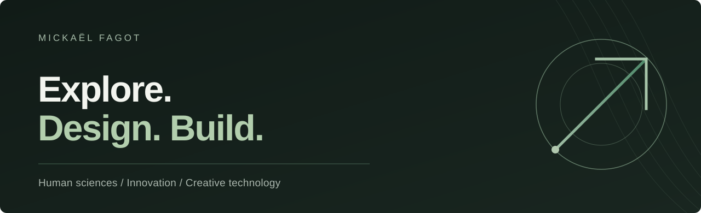

  

I'm Mickaël. My background is in **psychosociology**, and my work sits at the intersection of **innovation, design and human sciences**.

I spend a lot of time thinking about how people make decisions, work together and experience the systems around them. Professionally, that means researching problems, designing services and making complex ideas easier to use. Outside of work, it often means opening an editor and seeing whether an idea actually works.

This GitHub brings those two sides together. Not everything here is polished, and that's part of the point.

### Areas of interest

**Explore** — Human behaviour, organisations, change and new ways of working.

**Design** — Services, interfaces and experiences that make sense to the people using them.

**Build** — Web projects, AI experiments, prototypes and the occasional idea that started as a weekend distraction.

### A few projects

- [Personal website](https://github.com/Famickael/personal_website) — My own space on the web.
- [EVG roadbook](https://github.com/Famickael/roadbook-evg) — A small web project for organising a weekend together.
- [Projection mariage](https://github.com/Famickael/projection-mariage) — A project developed for a wedding.

Some work-related projects can't be shared publicly. Where possible, I'll document the methods, design decisions and lessons learned without disclosing confidential material.

---

Based in France · [LinkedIn](https://www.linkedin.com/in/mickaelfagot/)
